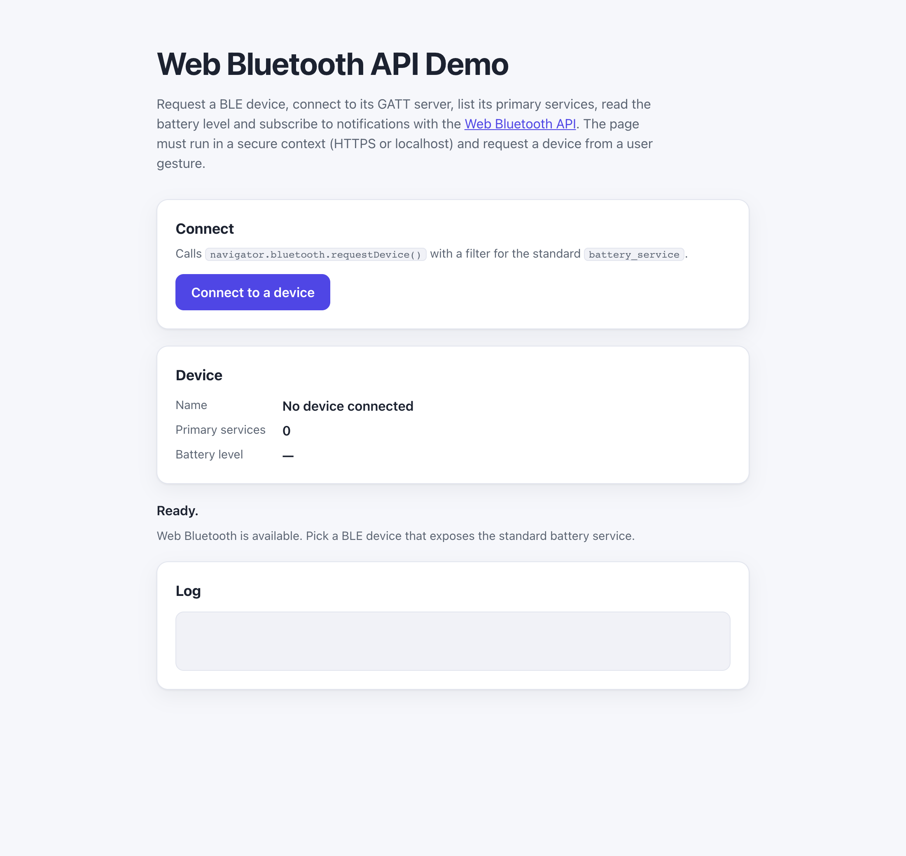

# WebSharper.WebBluetooth

[](https://github.com/dotnet-websharper/WebBluetooth)

WebSharper bindings for the [Web Bluetooth API](https://developer.mozilla.org/en-US/docs/Web/API/Web_Bluetooth_API) —
discovering, connecting to and exchanging data with Bluetooth Low Energy (BLE) devices
from F# and C# web apps.

Web Bluetooth is only available in [secure contexts](https://developer.mozilla.org/en-US/docs/Web/Security/Defenses/Secure_Contexts)
(HTTPS or localhost), and `navigator.bluetooth.requestDevice()` must be called from a
user gesture. Support is currently limited to Chromium-based browsers.

This repository contains:

| Project | Purpose |
| --- | --- |
| `WebSharper.WebBluetooth` | The binding: WIG definitions for `Bluetooth`, `BluetoothDevice`, `BluetoothRemoteGATTServer`, `BluetoothRemoteGATTService`, `BluetoothRemoteGATTCharacteristic`, `BluetoothRemoteGATTDescriptor`, `BluetoothAdvertisingEvent`, and their option dictionaries. |
| `WebSharper.WebBluetooth.Extensions` | `[<Inline>]` client extension: `Navigator.Bluetooth`. |
| `WebSharper.WebBluetooth.Sample` | An ASP.NET Core SPA that requests a BLE device, connects to its GATT server, lists primary services, reads the battery level and subscribes to notifications. |

## Live demos

**Try it live:** [Open the sample in your browser](https://dotnet-websharper.github.io/WebBluetooth/)



The sample doubles as the binding's [test case](#running-the-sample): it requests a BLE device, connects to its GATT server, and reads/notifies a characteristic.

- **Sample (this repository):** <https://dotnet-websharper.github.io/WebBluetooth/>
- **Source repository:** <https://github.com/dotnet-websharper/WebBluetooth>
- **WebSharper bindings:** <https://websharper.com/bindings>

## Features

- `navigator.bluetooth.getAvailability()`, `getDevices()` and `requestDevice()` with
  `filters`, `exclusionFilters`, `optionalServices` and `acceptAllDevices`.
- `BluetoothDevice`: `id`, `name`, the nullable `gatt` server, `forget()`,
  `watchAdvertisements()`/`unwatchAdvertisements()`, and the
  `ongattserverdisconnected` / `onadvertisementreceived` events.
- `BluetoothRemoteGATTServer`: `connect()`, `disconnect()`, `getPrimaryService(s)()`.
- `BluetoothRemoteGATTService`: `getCharacteristic(s)()`, `getIncludedService(s)()`, `device`, `uuid`.
- `BluetoothRemoteGATTCharacteristic`: `readValue()`, `writeValue*()`,
  `startNotifications()`/`stopNotifications()`, `getDescriptor(s)()`, and the
  `oncharacteristicvaluechanged` event.
- `BluetoothAdvertisingEvent` and `BluetoothAdvertisingEventInit` for advertisement data
  (`device`, `uuids`, `name`, `appearance`, `txPower`, `rssi`, `manufacturerData`, `serviceData`).
- `BluetoothUUID` helpers: `canonicalUUID`, `getService`, `getCharacteristic`, `getDescriptor`.

## Installation

The binding is not currently published to NuGet. Reference the projects from source:

```bash
git clone https://github.com/dotnet-websharper/WebBluetooth.git
```

```xml
<ItemGroup>
  <ProjectReference Include="path/to/WebSharper.WebBluetooth/WebSharper.WebBluetooth.fsproj" />
  <ProjectReference Include="path/to/WebSharper.WebBluetooth.Extensions/WebSharper.WebBluetooth.Extensions.fsproj" />
</ItemGroup>
```

## Usage

```fsharp
namespace WebSharper.WebBluetooth.Demo

open WebSharper
open WebSharper.JavaScript
open WebSharper.WebBluetooth

[<JavaScript>]
module Demo =
    // navigator.bluetooth is undefined in browsers without Web Bluetooth.
    let bluetoothObject: obj = JS.Window.Navigator?bluetooth
    let bluetoothAvailable =
        not (isNull bluetoothObject) && not (bluetoothObject ===. JS.Undefined)

    let bluetooth = As<Bluetooth> bluetoothObject

    let readBatteryLevel () =
        promise {
            try
                let! device =
                    bluetooth.RequestDevice(
                        RequestDeviceOptions(
                            Filters = [| BluetoothDeviceFilter(Services = [| "battery_service" |]) |]))

                let gatt = device.Gatt
                if Optional.isUndefined gatt || isNull (box gatt) then
                    Console.Log("This device does not expose a GATT server.")
                else
                    let! server = gatt.Value.Connect()
                    let! _services = server.GetPrimaryServices()
                    let! service = server.GetPrimaryService("battery_service")
                    let! characteristic = service.GetCharacteristic("battery_level")
                    let! value = characteristic.ReadValue()
                    Console.Log("Battery level:", value.GetUint8(0))

                    characteristic.OnCharacteristicValueChanged <- fun _ ->
                        Console.Log("Battery level changed:", characteristic.Value.GetUint8(0))

                    let! _ = characteristic.StartNotifications()
                    Console.Log("Subscribed to battery_level notifications.")
            with ex ->
                Console.Error("Bluetooth operation failed:", ex.Message)
        }
```

`requestDevice()` must be called in response to a user gesture (for example, a button
click). The returned `device.Gatt` property is optional: it is undefined for devices that
do not expose a GATT server.

## Running the sample

Build the sample in Release and serve its static output:

```bash
dotnet build WebSharper.WebBluetooth.Sample/WebSharper.WebBluetooth.Sample.fsproj -c Release
python3 -m http.server -d WebSharper.WebBluetooth.Sample/wwwroot 5823
```

Open <http://localhost:5823/>. Localhost counts as a secure context, so the API is
available in browsers that support it. Click **Connect to a device** and pick a BLE device
that advertises the battery service.

Alternatively, run the ASP.NET Core host:

```bash
dotnet run --project WebSharper.WebBluetooth.Sample
```

## Building from source

### Prerequisites

- [.NET SDK 10](https://dotnet.microsoft.com/download) or later.

### Build

```bash
dotnet build WebSharper.WebBluetooth.sln -c Release
```

The binding projects target `netstandard2.0`; the sample targets `net10.0`.

## Deployment

Pushing to `main` triggers `.github/workflows/ghpages.yml`, which builds the sample in
Release and publishes `WebSharper.WebBluetooth.Sample/wwwroot` to the `gh-pages` branch.

## Repository layout

```
WebSharper.WebBluetooth/              # binding (WIG definitions)
  Main.fs
WebSharper.WebBluetooth.Extensions/   # [<Inline>] client extensions
  Library.fs
WebSharper.WebBluetooth.Sample/       # ASP.NET Core SPA demo
  Client.fs
  Startup.fs
  wwwroot/
    index.html
    site.css
.github/workflows/ghpages.yml         # build + deploy the sample to GitHub Pages
```

## Notes on the API

- **Secure context and user gesture:** `navigator.bluetooth` is only exposed in secure
  contexts (HTTPS or localhost), and `requestDevice()` must be called from a user gesture.
  Handle rejected promises.
- **Not in headless browsers:** automated / headless Chrome usually does not expose Web
  Bluetooth, so the sample detects the API and degrades gracefully with an explanatory
  message. Use a regular Chromium-based browser over HTTPS or localhost to try it.
- **Filters:** pass `Filters = [| BluetoothDeviceFilter(Services = [| "..." |]) |]` to
  `requestDevice()` to restrict the chooser, and list any extra services you intend to use
  in `OptionalServices`.
- **Optional GATT server:** `BluetoothDevice.gatt` is an `Optional<BluetoothRemoteGATTServer>`;
  check `Optional.isUndefined` (and `isNull`) before calling `Connect()`.
- **Notifications:** set `OnCharacteristicValueChanged` and call `StartNotifications()` to
  receive `characteristicvaluechanged` updates. Read `characteristic.Value` inside the
  handler.
- **Advertising:** `WatchAdvertisements()` requires a user gesture and a supporting browser;
  `OnAdvertisementReceived` delivers a `BluetoothAdvertisingEvent` with the advertised
  `Device`, `Uuids`, `Name`, `Appearance`, `TxPower`, `Rssi`, `ManufacturerData` and
  `ServiceData`.
- **Characteristic events:** `OnCharacteristicValueChanged` on a characteristic and
  `OnGattServerDisconnected` / `OnAdvertisementReceived` on a device are exposed with
  friendly .NET names; the lowercase JavaScript property names remain available as obsolete
  aliases.

## License

Apache 2.0 — see [LICENSE.md](LICENSE.md).
